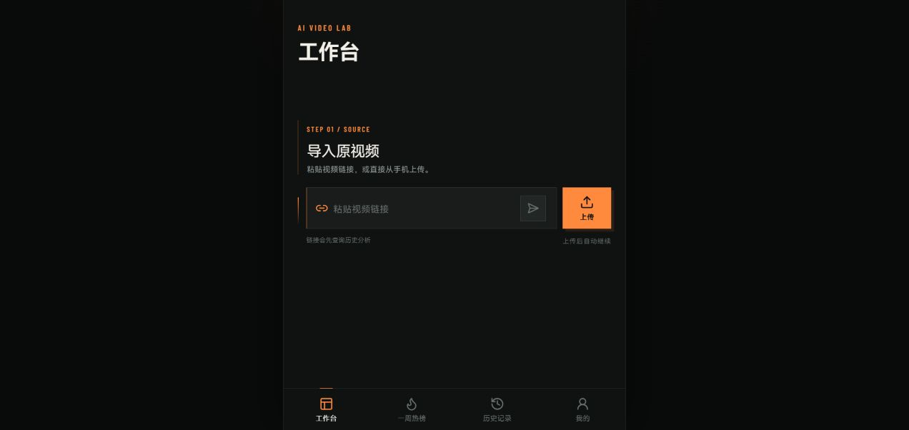
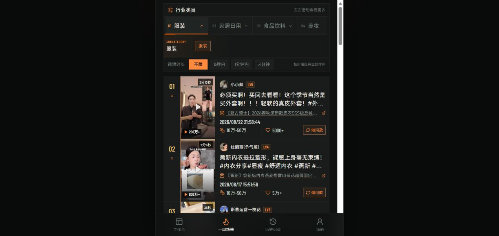

# 帧作 · 竖屏 AI 视频工作台

面向移动端内容制作流程的 React/TypeScript 前端工作台，将原视频导入、分析、参考素材、再创作、一周热榜、任务历史和个人记录放入统一的竖屏操作界面。项目支持演示数据模式，并定义了可对接真实后端的数据提供器。

## 功能概览

- 原视频链接与本地视频导入入口，以及产品、人物或场景参考图选择。
- 工作台按视频分析与后续制作阶段组织界面和任务状态。
- 一周热榜支持行业、子类、时长筛选及素材再创作入口。
- 历史任务、账户摘要、消耗和充值记录使用统一数据接口。

## 界面截图

### 竖屏工作台：原视频链接与上传入口



### 一周热榜：行业筛选与视频列表



截图使用 mock 演示模式。页面中的热榜、账户、额度及任务结果不能作为实时业务数据；真实分析、生成、存储和下载能力需要符合契约的后端服务。

## 操作流程

1. 安装依赖并运行 npm run dev。
2. 在演示模式中浏览工作台、热榜、历史记录和个人页面。
3. 导入或选择演示素材，按界面步骤查看分析和制作状态。
4. 接入后端时切换 api 模式，并逐项实现接口契约。

## 环境与启动

项目采用 React、TypeScript、Vite、React Router 和 Lucide 图标。建议使用满足 Vite 7 要求的 Node.js 22.12+。

```powershell
npm install
npm run dev
```

打开终端打印的地址。`npm run build` 执行类型构建并生成 `dist/`，`npm run preview` 预览构建结果；还提供 `npm run typecheck`、`npm run lint` 和 `npm test`。

## 演示模式与真实接口

未指定 `VITE_DATA_MODE` 时默认使用 `mock`。该模式通过本地数据提供器演示界面。接入真实服务时，在本地环境文件中设置：

```dotenv
VITE_DATA_MODE=api
VITE_API_BASE_URL=http://127.0.0.1:8000
```

API 模式要求提供基础地址，缺失时直接报错；业务接口失败不会自动伪装成模拟成功。接口约定以 [前端接口契约](docs/api-contract.md) 为准，包含 `/api/v1` 前缀、响应结构、错误、分页、热榜、视频分析、任务和账户记录。当前契约说明前端不发送 Cookie 或 Authorization，接入需要鉴权的生产服务前须另行完善。

## 源码入口

| 路径 | 作用 |
| --- | --- |
| `src/main.tsx` | React 与 HashRouter 启动 |
| `src/App.tsx` | 页面导航及主要业务界面 |
| `src/workspace/` | 视频工作台流程组件 |
| `src/data/providerInstance.ts` | mock/api 模式选择 |
| `src/data/mockDataProvider.ts` | 本地演示数据 |
| `src/data/httpDataProvider.ts` | HTTP 后端适配 |
| `public/` | 热榜封面、头像等静态资源 |

## 使用范围

仓库以可运行前端和明确接口为交付基础，不包含可据此宣称已上线的真实视频生成服务。素材、接口、账户鉴权和计费均需要按部署环境核实。
